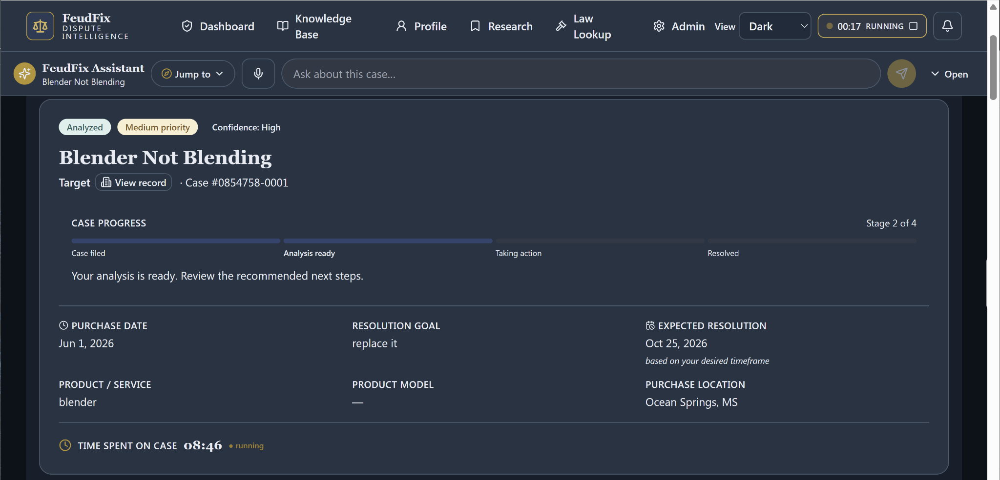

# FeudFix

**AI-Powered Consumer Dispute Intelligence & Case Management**

FeudFix is a full-stack application designed to help consumers research, organize, and manage disputes with businesses.

The platform combines structured case management, document analysis, company policy research, and AI-assisted workflows to help users make informed decisions and track their progress toward resolution.

## Application Screenshot

*FeudFix case management interface showing dispute analysis, progress tracking, and the AI assistant.*

## Key Capabilities

- **Conversational case intake** — Collect dispute details through a guided, interactive experience.
- **Case management** — Organize complaints, supporting evidence, correspondence, and case history.
- **Document analysis** — Examine supporting materials and identify information relevant to a dispute.
- **Company and policy research** — Research businesses, policies, and relevant dispute-resolution information.
- **AI-assisted strategy development** — Generate potential approaches based on case circumstances.
- **Correspondence generation** — Prepare dispute letters and other case communications.
- **Workflow automation** — Support follow-ups, reminders, and case progression.
- **Administrative tools** — Manage application settings and operational workflows.

## Technology Stack

| Layer | Technologies |
|---|---|
| Frontend | React, JavaScript |
| Backend | Node.js, REST APIs |
| Database | PostgreSQL |
| AI integration | Large Language Models, OpenRouter |
| Deployment | Linux, Docker |

## My Role

I designed and developed FeudFix, including:

- Requirements analysis and application architecture
- Database and workflow design
- Frontend and backend development
- AI integration and prompt engineering
- External service integration
- Deployment, testing, and iterative improvement

## Engineering Focus

FeudFix demonstrates the application of AI to practical business workflows rather than AI as a standalone feature.

Its architecture brings together conversational interfaces, persistent case records, document processing, external information sources, and automated workflows in a unified application.

## Source Code

The application source code is maintained in a private repository. This public repository is intended for portfolio documentation and project demonstrations.

## Contact

**Rob Cosgrove**  
Software Architect & Full-Stack Developer

- Portfolio: https://robspace.me
- GitHub: https://github.com/rscosgrovejr
- LinkedIn: https://www.linkedin.com/in/rob-cosgrove-75639839a
- Email: robcosgrove@gmail.com# FeudFix-Portfolio
